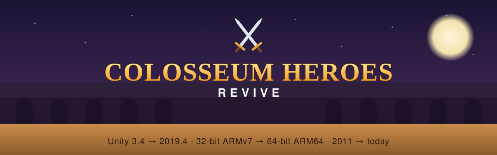
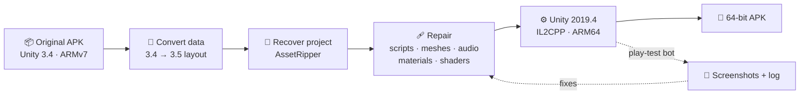

<p align="center">
  
</p>

<p align="center">
  
  
  
  
  
</p>

<p align="center">
  <b>Bringing a 2011 Android game back to life on today's 64-bit phones, without remaking it.</b>
</p>

---

## ✨ What this is

**Colosseum Heroes** (Gamevil, 2011) was built with Unity 3.4 for 32-bit ARM phones. Modern phones
such as the Galaxy S24 FE run **64-bit code only**, so the original APK won't even install.

This project is the **toolkit used to port the original game** to Unity 2019.4 and build a **64-bit IL2CPP**
APK from it: the same scenes, scripts, art and sounds, running on a modern engine. It contains only the
code written for the port. **No game files are included** (see [Legal](#%EF%B8%8F-legal)).

<table>
<tr>
<td width="50%" valign="top">

### 🎮 Result
- Runs natively on **ARM64** (and ARMv7)
- Original menus, shop, tutorial and battles
- Restored materials, textures, audio and shaders
- **Options:** adjustable **button size** (100–200%) and **HUD text size** (50–200%)
- Dead 2011 online services replaced with friendly messages

</td>
<td width="50%" valign="top">

### 🛠️ Inside this repo
- A **UnityScript/Boo runtime replacement** that works under IL2CPP
- A **GUIText** stand-in (removed from Unity in 2019.3)
- Replacements for **Unity 3.4 built-in shaders**
- One-click **APK build** and an automated **play-test** bot
- Python tools that **recover the project** from the old APK data

</td>
</tr>
</table>

## 🧭 How the port works



The full story, with every problem met along the way and how it was solved, is in
**[docs/HOW-IT-WORKS.md](docs/HOW-IT-WORKS.md)**.

## 📁 Repository layout

```
unity/Assets/
├── Plugins/Compat/        UnityScript runtime, GUIText stand-in, dialogs, size settings
├── Shaders/Compat/        Unity 3.4 built-in shader replacements
└── Editor/                One-click 64-bit build + automated play-test
tools/
├── build/                 Windows: install Unity/SDK/NDK/JDK on D:, then build loop
├── port/                  Recovery and repair scripts (data conversion, meshes, refs, smali)
└── materials/             Restore material ↔ texture links from the original game data
docs/                      How it works, banner
```

## 🚀 Build it yourself

You need **your own copy** of the original *Colosseum Heroes v1.0.1* APK.

1. **Recover the project:** unpack the APK, convert its `assets/bin/Data` with
   `tools/port/convert34to35.py`, then open it with [AssetRipper](https://github.com/AssetRipper/AssetRipper)
   and export a Unity project.
2. **Repair it:** run the scripts in `tools/port/` and `tools/materials/` (each file starts with its usage).
3. **Add the port code:** copy everything from `unity/Assets/` into the project's `Assets/` folder.
4. **Install the build tools (Windows):** run `tools/build/Start-Build.cmd`. It installs Unity 2019.4.41f2,
   the Android SDK, NDK r19 and OpenJDK 8, all verified by checksum, then starts the build loop.
5. **Build:** in Unity choose **Colosseum Heroes → Build 64-bit APK**, or let the build loop do it.
   The APK lands in `Builds/ColosseumHeroes-64bit.apk`.

> 💡 The build loop watches `build-request.txt`. Write `N` to build, `N play` to run the play-test bot,
> or `N pack` to archive the project.

## 🧪 Automated play-testing

`ColosseumHeroesPlayTest.cs` plays the game inside the editor with no one at the keyboard. It taps through
the menu, options, save slot, character, difficulty, tutorial and a first battle. Along the way it takes
screenshots and logs every camera, renderer, missing texture and exception. That's how most bugs in this
port were found and confirmed fixed.

## ⚖️ Legal

*Colosseum Heroes* and all of its code, art, audio and trademarks belong to **Gamevil Inc.**
(now **Com2uS Holdings**). This repository contains **none** of them: no game scripts, assets or APKs. It holds
only original code written for the port, released under the [MIT License](LICENSE). That license covers this
code only, not the game. To use it you need your own legitimately obtained copy of the game.

This is an unofficial fan preservation project, not affiliated with or endorsed by Gamevil or Com2uS.

---

<p align="center"><sub>Made with patience, 2011 log files, and a lot of play-test screenshots.</sub></p>
